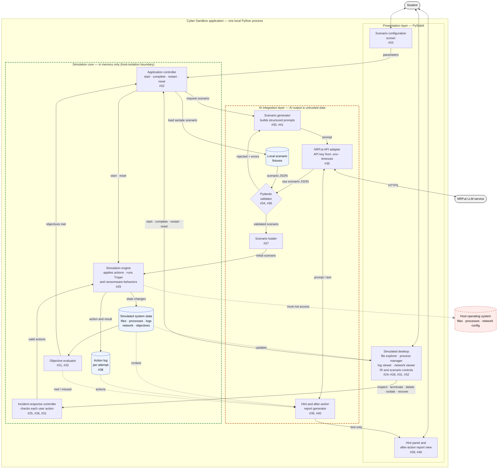

# Design — High-level architecture

> Epics: #22, #23 · Task: #53
> Stories: #24, #25, #26, #27, #28, #29, #30, #31, #32, #33, #34, #35, #36, #37, #38, #39, #40, #41
> Owner: danjobo · Sprint: 2 · Status: draft
> Specifications: [`../specs/training-environment.md`](../specs/training-environment.md), [`../specs/ai-scenarios.md`](../specs/ai-scenarios.md)

## 1. What this diagram answers

What are the major pieces of the Cyber Sandbox, how do they connect, and where
are the two safety boundaries? The first boundary keeps the simulation away
from the host computer. The second keeps AI output from reaching the
simulation until it has been validated.

*Figure 1 — High-level architecture. Green dashed box: the host-isolation
boundary (all simulation state stays in memory). Orange dashed box: the
untrusted-data boundary (AI output is data until the validator accepts it).
Solid arrows are calls or data handed over; dotted arrows are reads or update
notifications; the arrow ending in an X is a forbidden dependency. Issue
numbers are the objectives each component serves.*

## 2. Mermaid source

The exported image above is generated from this source. Edit this block, then
re-export `images/architecture-diagram.png` (for example at
[mermaid.live](https://mermaid.live) or with `mmdc -i <file> -o <image>`).

## 3. Components

| Layer | Component | Responsibility | Serves |
|---|---|---|---|
| Presentation (PySide6) | Scenario configuration screen | Collects malware type, difficulty (easy, medium, hard) and attack path, or lets the student choose a sample scenario; blocks generation when a value is missing or unsupported | #33 |
| Presentation (PySide6) | Simulated desktop | File explorer, process manager, system log viewer and network activity viewer in one window, plus the incident-response and scenario controls | #24–#28, #31, #32 |
| Presentation (PySide6) | Hint panel and after-action report view | Display AI-written text; neither can change the simulation | #39, #40 |
| Simulation core | Application controller | Coordinates the application so the UI holds no logic: requests scenarios, starts, completes, restarts and resets them, and opens a new attempt each time | #32 |
| Simulation core | Incident-response controller | Single entry point for every user action (inspect, terminate, delete, isolate, recover). Rejects invalid actions without changing state and passes valid ones to the simulation engine | #25, #26, #31 |
| Simulation core | Simulation engine | The only component that changes simulation state. Loads the initial scenario, applies valid actions, runs the Trojan and ransomware behaviors, and records each action and its result in the action log | #25–#29, #38 |
| Simulation core | Simulated system state | Virtual file system, simulated processes, system logs, network activity and scenario objectives, all held in memory | #25–#28, #31 |
| Simulation core | Action log | Timestamped, ordered record of investigation and incident-response actions and their results, kept separately for each attempt | #38 |
| Simulation core | Objective evaluator | Checks the simulation state against the scenario objectives, tells the application controller when they are all met, and reports met and missed objectives to the feedback generator | #31, #32, #39 |
| AI integration | Scenario generator | Turns the selected parameters into a structured prompt and requests a scenario | #35, #41 |
| AI integration | NRP.ai API adapter | The only component that talks to the network. Reads the API key from `.env`, applies timeouts, and turns service errors into messages instead of crashes. It is our code, so it sits inside the application, not with the external service | #35 |
| AI integration | Pydantic validator | Accepts scenario JSON that matches the schema and rejects missing fields, wrong types, unsupported values and constraint violations, with the errors listed | #34, #36 |
| AI integration | Scenario loader | Converts a validated scenario into the initial simulation state. Loads all of it or none of it | #37 |
| AI integration | Hint and after-action report generator | Sends the active scenario, the action log and the objective results to the LLM and returns text for the hint panel and the after-action report | #39, #40 |
| AI integration | Local scenario fixtures | Hand-written scenario files. The tests use them, and the student can play one when NRP.ai is unavailable. They pass through the same validator and loader as AI output | #36, #41 |

## 4. Boundaries

**Host isolation (green).** Everything inside the simulation core is ordinary
Python objects in memory. The simulation engine is the only component that
changes simulation state, and it must not access the host operating system:
no host file, process or network-configuration calls, and the malware
behaviors are only changes to simulation state (training-environment spec
NFR-1 to NFR-3). The separate isolation tests for the Trojan and ransomware
behaviors (#30) are how this claim is checked.

**Untrusted AI data (orange).** Anything the NRP.ai service returns is treated
as data, never as code or commands (AI-scenarios spec NFR-1). Scenario JSON can
only reach the simulation core through the validator and then the loader, and
the loader writes nothing unless the whole scenario is valid (NFR-2, NFR-3).
Hints and reports come back as display text only; they never write to the
simulation state or complete objectives (NFR-8). The NRP.ai API adapter is the
only component with network access, which keeps the API key and error
handling in one place (NFR-4, NFR-5).

## 5. Main flows

1. **Generate and load.** Configuration screen → application controller →
   scenario generator → NRP.ai API adapter → NRP.ai → validator. A rejected
   scenario goes back to the scenario generator to be regenerated; a validated
   one goes to the loader, which hands it to the simulation engine to build the
   initial state. When NRP.ai is unavailable, the application controller loads a
   local fixture instead, and it enters at the validator, so fixtures follow the
   same path as AI output.
2. **Investigate and respond.** The student acts in the simulated desktop; the
   incident-response controller checks each action and passes valid ones to the
   simulation engine, which updates the state and records the action and its
   result in the action log. The desktop redraws from state updates.
3. **Complete.** The objective evaluator tells the application controller when
   every objective is met; the student can also complete, restart or reset from
   the scenario controls.
4. **Hints and after-action report.** The feedback generator reads the state,
   the action log and the objective results, asks the LLM through the NRP.ai API
   adapter, and shows the returned text in the hint panel or report view.

The order of calls over time is the subject of the sequence diagram (#57), and
the data each step carries is in the data flow diagram (Figure 3,
[`data-flow.md`](data-flow.md)) and the data model (Figure 4,
[`data-model.md`](data-model.md)). The screens the student moves through are in
the user flow diagram (Figure 6, [`user-flow.md`](user-flow.md)).

## 6. Design decisions

These choices were not settled by the specifications or the other design
documents. The team decided them while drawing this diagram.

| Decision | Options considered | Choice | Why |
|---|---|---|---|
| Does the UI or a controller coordinate the components? | The UI calls each component directly (an early sequence-diagram draft); an application controller between the UI and the rest | Application controller; the UI only displays and forwards input | Keeps the logic testable with pytest without opening a window, and keeps PySide6 code out of the simulation core |
| Do hints and reports use the LLM, and where do hints come from? | Generated live by the LLM (data flow diagram, Figure 3); pre-generated tiered hints stored in the scenario (data model, Figure 4); predefined guidance written by the team; no LLM | Both use the LLM through the NRP.ai API adapter, generated live from the current state | Objectives 2.7 and 2.8 are AI-assisted, and live generation lets a hint reflect what the student has already done (AI-scenarios spec FR-47) |
| When does a hint appear? | Only when the student asks; automatically with action results; on a trigger such as inactivity or a failed action (data model) | Only when the student asks | Matches AI-scenarios spec FR-46 and keeps the student responsible for the investigation |
| What makes a scenario complete? | All objectives met; the student chooses to finish; either | Either: all objectives met (detected by the objective evaluator) or the student chooses to finish | A student who finishes everything gets an automatic end, and a student who is stuck can still end the scenario and get the after-action report |
| What drives the malware during play? | The AI defines the malware behavior in the scenario; built-in Trojan and ransomware behaviors only; the AI generates the starting scenario and built-in behaviors run during play | The AI generates the starting scenario; the built-in simulation engine runs the Trojan and ransomware behaviors | Satisfies training-environment spec FR-15 to FR-17 with behaviors that can be tested for host isolation (#30), while the AI still varies the scenario content |
| Is anything saved to disk? | Everything stays in memory; action logs and reports are saved to files | Nothing is saved for the prototype; action logs and reports stay in memory | Matches proposal §4 (in-memory state) and training-environment spec NFR-3, which forbids modifying host files |
| What happens when validation fails? | Regenerate automatically (data flow diagram, Figure 3); show the errors to the student; return the student to configuration | Regenerate automatically. If a scenario still cannot be produced, for example because NRP.ai is unavailable, the student sees an error and can retry or return to the dashboard (user flow diagram, Figure 6) | Most validation failures are fixed by asking again, and the error path meets the fail-safe requirement (AI-scenarios spec NFR-5) |
| Can a student play a scenario when NRP.ai is unavailable? | Fixtures used only by the tests; fixtures used by the tests and also playable | Yes: a local fixture can be played, and it passes through the same validator and loader as AI output | Allows demos without network access and lets the desktop, engine and loader be built before the NRP.ai integration (#35) is finished |

## 7. Not designed yet

This diagram fixes the components and how they connect. These details are
still open, and the components that own them are shown without them:

- **Retry limits and timeouts:** how many times the scenario generator
  regenerates a rejected scenario, and how long the NRP.ai API adapter waits
  for a response.
- **Scenario schema fields:** the exact fields for files, processes, logs,
  network connections and objectives (#34; open question in the AI-scenarios
  spec).
- **NRP.ai request format:** the API format, model, authentication method and
  response mode (#35; open question in the AI-scenarios spec).
- **Supported options:** which malware categories and attack paths the
  configuration screen offers first (#33).
- **Malware details:** the specific effects of the Trojan and ransomware, which
  files they affect, and when the Trojan activates (#29; open questions in the
  training-environment spec).
- **Incident-response actions:** exactly which actions count as identifying,
  containing, removing and recovering (#31).
- **What is sent to the LLM:** which scenario and action-log information is
  included in prompts, and what is left out (open question in the AI-scenarios
  spec).
- **Keeping the window responsive:** how LLM calls run without freezing the
  PySide6 interface while waiting for NRP.ai.
- **Invalid simulation state:** how the application responds if the simulation
  reaches a state it should not be in (open question in the
  training-environment spec).
- **Prototype folder layout:** how these components map to modules in
  `prototype/`.

## 8. Traceability

| Objective | Component(s) |
|---|---|
| 1.1 Simulated desktop (#24) | Simulated desktop |
| 1.2 Virtual file system (#25) | Simulated desktop, incident-response controller, simulation engine, simulated system state |
| 1.3 Process manager (#26) | Simulated desktop, incident-response controller, simulation engine, simulated system state |
| 1.4 System log viewer (#27) | Simulated desktop, simulated system state |
| 1.5 Network activity viewer (#28) | Simulated desktop, simulated system state |
| 1.6 Simulated malware behaviors (#29) | Simulation engine |
| 1.7 Host-isolation tests (#30) | Host-isolation boundary |
| 1.8 Incident-response controls (#31) | Simulated desktop, incident-response controller, objective evaluator |
| 1.9 Scenario controls (#32) | Simulated desktop, application controller, objective evaluator |
| 2.1 Scenario configuration (#33) | Scenario configuration screen |
| 2.2 Scenario schema (#34) | Pydantic validator |
| 2.3 NRP.ai integration (#35) | Scenario generator, NRP.ai API adapter |
| 2.4 Pydantic validation (#36) | Pydantic validator, local scenario fixtures |
| 2.5 Scenario loader (#37) | Scenario loader, simulation engine |
| 2.6 Action logging (#38) | Simulation engine, action log |
| 2.7 After-action report (#39) | Hint and after-action report generator, report view |
| 2.8 Hint system (#40) | Hint and after-action report generator, hint panel |
| 2.9 Scenario variability (#41) | Scenario generator, local scenario fixtures |
