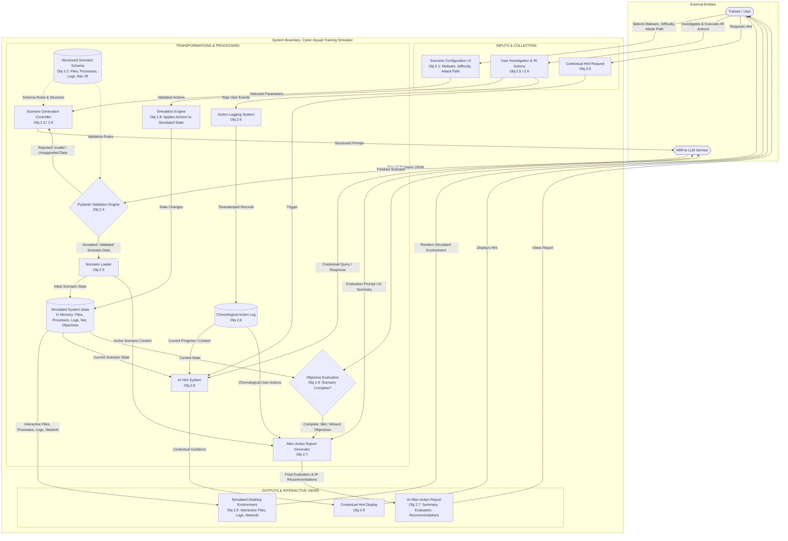

# Data Flow Diagram (DFD)

* **Epic:** Issue #23 (AI-Driven Cybersecurity Incident-Response Training Simulator)
* **Design Task:** Issue #55 (Data Flow Diagram)
* **User Stories / Objectives:** #33 (Obj 2.1), #34 (Obj 2.2), #35 (Obj 2.3), #36 (Obj 2.4), #37 (Obj 2.5), #38 (Obj 2.6), #39 (Obj 2.7), #40 (Obj 2.8), #41 (Obj 2.9)
* **Related Goal 1 Objectives:** #31 (Obj 1.8), #32 (Obj 1.9)

## Overview

This document models how user parameters, AI-generated scenario payloads, and trainee investigation actions flow and transform across the Cyber-Squad Incident-Response Training Simulator. All runtime data is held in memory; nothing is written to disk in the prototype ([architecture.md §6](architecture.md)).

**Figure 3:** End-to-end data flow from user scenario configuration through NRP.ai generation, Pydantic validation, interactive desktop execution, chronological action logging, and AI after-action reporting.

## Mermaid Source

## Legend & Notation

* **Stadium Node `([ ])`:** External Entity (Trainee / User, External NRP.ai API).
* **Rectangle `[ ]`:** System Process, Transformation, or UI View.
* **Diamond `{ }`:** Validation Gate / Decision Point (`Pydantic Validation Engine`, `Objective Evaluation`).
* **Cylinder `[( )]`:** Schema Definition or In-Memory Data Store (`Structured Scenario Schema`, `Chronological Action Log`, `Simulated System State`). Nothing is written to disk in the prototype.
* **Solid Arrow `-->`:** Direct synchronous data movement or event payload.
* **Bidirectional Arrow `<-->`:** Request/Response API cycle with NRP.ai.
* **Dotted Arrow `-.->`:** Read-only schema/configuration constraint applied to a process.

## Story & Objective Traceability

* **Objective 2.1 (#33):** `Scenario Configuration UI` collects malware type, difficulty (easy, medium, hard), and attack path.
* **Objective 2.2 (#34):** `Structured Scenario Schema` defines simulated files, processes, logs, network activity, and incident-response objectives.
* **Objective 2.3 (#35) & 2.9 (#41):** `Scenario Generation Controller` queries the `NRP.ai LLM Service` to generate distinct, valid scenarios from identical or varied input parameters.
* **Objective 2.4 (#36):** `Pydantic Validation Engine` accepts valid scenario JSON and rejects invalid or unsupported data back for regeneration.
* **Objective 2.5 (#37):** `Scenario Loader` transforms validated AI JSON into the initial `Simulated System State`, which the `Simulated Desktop Environment` displays.
* **Objective 2.6 (#38):** `Action-Logging System` records user investigation and incident-response actions in chronological order inside the `Chronological Action Log`.
* **Objective 2.7 (#39):** `After-Action Report Generator` combines scenario data and logged user actions via `NRP.ai` to generate the `AI After-Action Report`.
* **Objective 2.8 (#40):** `AI Hint System` uses active scenario progress and `NRP.ai` to deliver optional `Contextual Hint Display` guidance.
* **Objective 1.8 (#31):** `Simulation Engine` applies validated investigation and incident-response actions to the `Simulated System State`, and the desktop shows the result.
* **Objective 1.9 (#32):** `Objective Evaluation` completes the scenario when all objectives are met or the trainee finishes, and passes met and missed objectives to the `After-Action Report Generator`.
