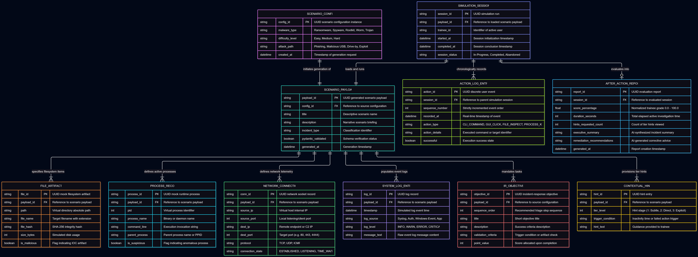

# Data Model Specification (ERD)

* **Epic:** Issue #23 (AI-Driven Cybersecurity Incident-Response Training Simulator)
* **Design Task:** Issue #56 (Data Model & Entity-Relationship Diagram)
* **User Stories / Objectives:** #33 (Obj 2.1), #34 (Obj 2.2), #35 (Obj 2.3), #36 (Obj 2.4), #37 (Obj 2.5), #38 (Obj 2.6), #39 (Obj 2.7), #40 (Obj 2.8), #41 (Obj 2.9)

## Overview

This document specifies the structural data entities, attributes, constraints, and relationships governing the Cyber-Squad Incident-Response Training Simulator. The schema provides strong typing for incoming AI-generated scenario payloads via Pydantic validation, structures interactive virtual artifacts (files, processes, logs, network connections), records high-fidelity chronological trainee telemetry, and formats after-action assessment reports.


**Figure 4:** Entity-Relationship Diagram (ERD) modeling scenario configuration, structured payload components, runtime action telemetry, hints, and evaluation reporting.

## Mermaid Source

```mermaid
erDiagram
    SCENARIO_CONFIG ||--|| SCENARIO_PAYLOAD : "initiates generation of"
    SCENARIO_PAYLOAD ||--|{ FILE_ARTIFACT : "specifies filesystem items"
    SCENARIO_PAYLOAD ||--|{ PROCESS_RECORD : "defines active processes"
    SCENARIO_PAYLOAD ||--|{ NETWORK_CONNECTION : "defines network telemetry"
    SCENARIO_PAYLOAD ||--|{ SYSTEM_LOG_ENTRY : "populates event logs"
    SCENARIO_PAYLOAD ||--|{ IR_OBJECTIVE : "mandates tasks"
    SCENARIO_PAYLOAD ||--|{ CONTEXTUAL_HINT : "provisions tier hints"

    SIMULATION_SESSION ||--|| SCENARIO_PAYLOAD : "loads and runs"
    SIMULATION_SESSION ||--|{ ACTION_LOG_ENTRY : "chronologically records"
    SIMULATION_SESSION ||--o| AFTER_ACTION_REPORT : "evaluates into"

    SCENARIO_CONFIG {
        string config_id PK "UUID scenario configuration instance"
        string malware_type "Ransomware, Spyware, Rootkit, Worm, Trojan"
        string difficulty_level "Easy, Medium, Hard"
        string attack_path "Phishing, Malicious USB, Drive-by, Exploit"
        datetime created_at "Timestamp of generation request"
    }

    SCENARIO_PAYLOAD {
        string payload_id PK "UUID generated scenario payload"
        string config_id FK "Reference to source configuration"
        string title "Descriptive scenario name"
        string description "Narrative scenario briefing"
        string incident_type "Classification identifier"
        boolean pydantic_validated "Schema verification status"
        datetime generated_at "Generation timestamp"
    }

    FILE_ARTIFACT {
        string file_id PK "UUID mock filesystem artifact"
        string payload_id FK "Reference to scenario payload"
        string path "Virtual directory absolute path"
        string file_name "Target filename with extension"
        string file_hash "SHA-256 integrity hash"
        int size_bytes "Simulated disk usage"
        boolean is_malicious "Flag indicating IOC artifact"
    }

    PROCESS_RECORD {
        string process_id PK "UUID mock runtime process"
        string payload_id FK "Reference to scenario payload"
        int pid "Virtual process identifier"
        string process_name "Binary or daemon name"
        string command_line "Execution invocation string"
        string parent_process "Parent process name or PPID"
        boolean is_suspicious "Flag indicating anomalous process"
    }

    NETWORK_CONNECTION {
        string conn_id PK "UUID network socket record"
        string payload_id FK "Reference to scenario payload"
        string source_ip "Virtual host internal IP"
        int source_port "Local listening/client port"
        string dest_ip "Remote endpoint or C2 IP"
        int dest_port "Target port (e.g. 80, 443, 4444)"
        string protocol "TCP, UDP, ICMP"
        string connection_state "ESTABLISHED, LISTENING, TIME_WAIT"
    }

    SYSTEM_LOG_ENTRY {
        string log_id PK "UUID log record"
        string payload_id FK "Reference to scenario payload"
        datetime timestamp "Simulated log event time"
        string log_source "Syslog, Auth, Windows-Event, App"
        string log_level "INFO, WARN, ERROR, CRITICAL"
        string message_text "Raw event log message content"
    }

    IR_OBJECTIVE {
        string objective_id PK "UUID incident-response objective"
        string payload_id FK "Reference to scenario payload"
        int sequence_order "Recommended triage step sequence"
        string title "Short objective title"
        string description "Success criteria description"
        string validation_criteria "Trigger condition or artifact check"
        int point_value "Score allocated upon completion"
    }

    CONTEXTUAL_HINT {
        string hint_id PK "UUID hint entry"
        string payload_id FK "Reference to scenario payload"
        int tier_level "Hint stage (1: Subtle, 2: Direct, 3: Explicit)"
        string trigger_condition "Inactivity time or failed action trigger"
        string hint_text "Guidance provided to trainee"
    }

    SIMULATION_SESSION {
        string session_id PK "UUID simulation run"
        string payload_id FK "Reference to loaded scenario payload"
        string trainee_id "Identifier of active user"
        datetime started_at "Session initialization timestamp"
        datetime completed_at "Session conclusion timestamp"
        string session_status "In-Progress, Completed, Abandoned"
    }

    ACTION_LOG_ENTRY {
        string action_id PK "UUID discrete user event"
        string session_id FK "Reference to parent simulation session"
        int sequence_number "Strictly incremented event order"
        datetime recorded_at "Real-time timestamp of event"
        string action_type "CLI_COMMAND, GUI_CLICK, FILE_INSPECT, PROCESS_KILL"
        string action_details "Executed command or target identifier"
        boolean successful "Execution success state"
    }

    AFTER_ACTION_REPORT {
        string report_id PK "UUID evaluation report"
        string session_id FK "Reference to evaluated session"
        float score_percentage "Normalized trainee grade 0.0 - 100.0"
        int duration_seconds "Total elapsed active investigation time"
        int hints_requested_count "Count of tier hints viewed"
        string executive_summary "AI-synthesized incident summary"
        string remediation_recommendations "AI-generated corrective advice"
        datetime generated_at "Report creation timestamp"
    }