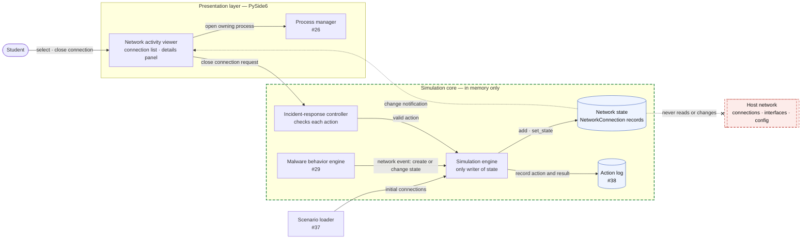
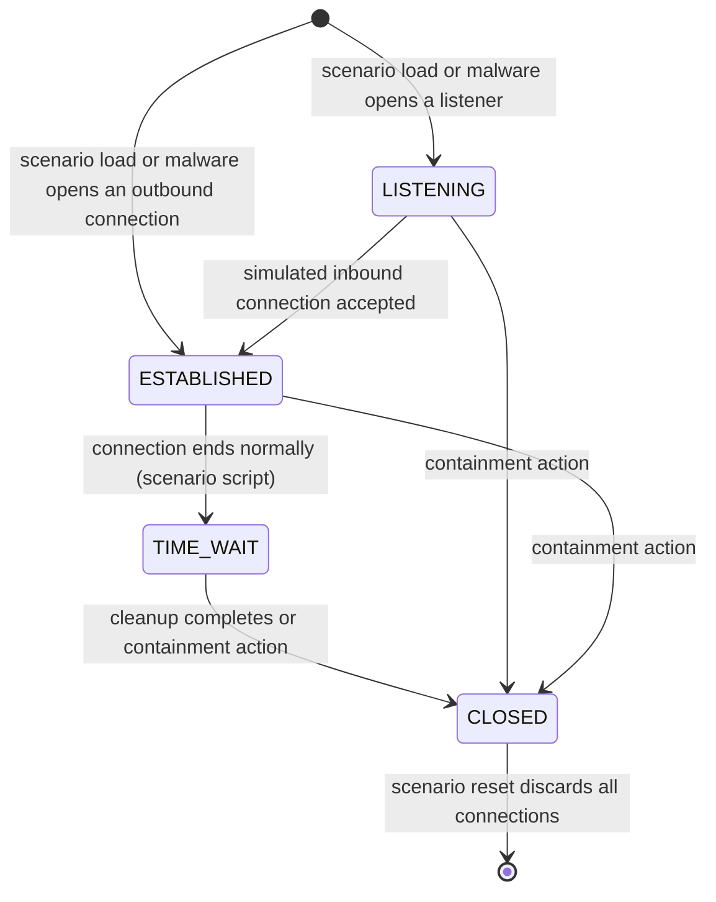

# Design — Network activity viewer

> Epic: #22 · Story: #28 · Feature: #105 · Tasks: #106, #107, #108, #109, #110
> Owner: danjobo · Sprint: 3 · Status: draft
> Specification: [`../specs/training-environment.md`](../specs/training-environment.md), "Network activity viewer" section (FR-11 to FR-13, FR-11.1 to FR-13.4, AC1 to AC6)

## Summary

The network activity viewer is the desktop tool in which the student inspects
the simulated network connections of a scenario: what is listening, what is
talking to the outside, and which process is responsible. It is designed in
CPSC 490 and implemented in CPSC 491. This document fixes where the viewer
sits in the architecture, the components it is built from and the interfaces
between them, the lifecycle of a connection, the screen layout, and the
decisions behind each choice, so that implementation can start directly from
it. Tags such as **[AC3]** point to the acceptance criteria of #28, and
requirement IDs such as FR-12.6 point to the specification.

## 1. Context

The viewer is one of the four tools in the simulated desktop, alongside the
file explorer, the process manager and the system log viewer (Figure 1,
[`architecture.md`](architecture.md)). Like the other tools, it belongs to the
presentation layer and holds no simulation data of its own. Everything it
shows comes from the network state inside the simulation core, and
everything it changes goes through the incident-response controller.

Three things put connections into the network state. When a scenario starts,
the scenario loader (#37) passes the scenario's initial connections to the
simulation engine. While the student investigates, the malware behavior
engine (#29) sends network events that create connections or change their
state, for example a Trojan opening an outbound channel to its
command-and-control server. Finally, the student can close a connection as a
containment action (#31). In all three cases the simulation engine is the
only component that writes to the network state, which matches the
architecture's rule that the engine is the single writer of simulation state.

The viewer never looks past the simulation core. It does not read the host
computer's connections, interfaces, routing tables or sockets, and closing a
connection in the viewer changes nothing outside the application
**[AC6]** (FR-13.1 to FR-13.3). This boundary is drawn in Figure 9 as the
forbidden link to the host network.

## 2. Components and interfaces (#106)

*Figure 9 — Network activity viewer components. Solid arrows are calls or
data handed over; dotted arrows are change notifications; the arrow ending in
an X is a forbidden dependency. The green dashed box is the in-memory
simulation core.*

Figure 9 shows the five components involved in the viewer and how they
connect. Two of them are new: the network state and the viewer itself. The
other three, the simulation engine, the incident-response controller and the
malware behavior engine, already exist in the architecture and gain the
responsibilities described below.

| Component | Layer | Responsibility | Interface |
|---|---|---|---|
| `NetworkConnection` | Simulation core | One simulated connection, validated with Pydantic: addresses, ports, protocol, state, and optional owning process | Fields from NETWORK_CONNECTION (Figure 4) |
| Network state | Simulation core | Holds every connection of the active scenario in memory and notifies subscribers when one is added or changes state | `add(connection)`, `set_state(conn_id, state)`, `get(conn_id)`, `all()`, `subscribe(callback)` |
| Simulation engine | Simulation core | The only writer of the network state; applies initial connections, malware network events and accepted close actions, and records each action in the action log | `apply_network_event(event)`, `close_connection(conn_id)` |
| Incident-response controller | Simulation core | Checks a close request: rejects it if the connection does not exist or is already CLOSED, otherwise passes it to the engine (FR-12.4, FR-12.5) | `request_close(conn_id)` |
| Network activity viewer | Presentation | Shows the connection list and the details panel, highlights changes, and forwards the student's actions | Subscribes to the network state; calls `request_close` and the process manager's `show_process(pid)` |

**The network state** is a plain in-memory collection keyed by connection ID.
`add` accepts a validated `NetworkConnection`; `set_state` changes one
connection's state and rejects unknown IDs or changes away from CLOSED, so
an invalid change can never leave the state half-updated. After every
successful change the network state calls each subscriber with the changed
connection. This is the only way the viewer learns about changes **[AC4]**.

**The network event** is the single message the malware behavior engine
sends when simulated malware touches the network (FR-12.6). It has two kinds:
*created*, which carries a full connection including its owning process
(FR-12.7), and *state changed*, which carries a connection ID and the new
state. Because scripted scenarios and AI-generated scenarios both reach the
viewer through this one event, the viewer behaves the same for both
**[AC5]**.

**The viewer** has two parts. The connection list is a table model over the
network state with one row per connection, in every state, and the five
columns from the specification **[AC1] [AC2]**. The details panel shows the
selected connection's protocol, connection ID, direction and owning process
**[AC3]**. Direction is derived rather than stored: a connection is outbound
when its source address is the simulated host's private address and its
destination is outside that private range, and inbound otherwise. When the
selected connection has an owning process, the panel offers a link that asks
the process manager (#26) to show that process (FR-11.4).

## 3. Connection lifecycle (#107)

*Figure 10 — Connection-status lifecycle. Every transition is labelled with
the event that causes it.*

Figure 10 shows the four states a simulated connection can be in and every
way it can move between them. A connection enters the simulation in one of
two states. A *listener*, such as a backdoor port opened by malware, starts
as LISTENING. An *outbound* connection, such as a Trojan contacting its
command-and-control server, starts as ESTABLISHED. Either can come from the
scenario's initial data or from a malware network event.

From LISTENING, a connection becomes ESTABLISHED when the scenario simulates
an inbound connection being accepted. From ESTABLISHED, it moves to TIME_WAIT
when the scenario script ends it normally, and from TIME_WAIT it moves to
CLOSED when cleanup completes. These transitions mirror what a real operating
system reports, so the student learns to read the same states they will see
in real tools.

The transitions that matter most for training are the containment arrows.
From any of the three open states, a containment action by the student moves
the connection to CLOSED **[AC4]** (FR-12.4). CLOSED is final: the
incident-response controller rejects any further action on a closed
connection, and the connection stays in the list so the student can see what
was contained (FR-12.5). Only a scenario reset removes connections, and it
removes all of them at once by discarding the network state.

## 4. Screen layout (#108)

*Figure 11 — Network viewer wireframe. Numbered markers are explained below
the window. Editable source:
[`wireframes/network-viewer-wireframe.html`](wireframes/network-viewer-wireframe.html).*

Figure 11 shows the viewer as the student will see it during a Trojan
scenario. The viewer is a tab of the simulated desktop rather than a separate
window, so the student can switch between the network, process and log views
while following one lead **[AC1]**. The connection list takes most of the
width because scanning connections is the main task; the five columns are
ordered as an analyst reads them, from where a connection starts to where it
goes and whether it is still open **[AC2]**.

The details panel sits beside the list instead of replacing it, so selecting
a connection never loses the student's place **[AC3]**. Its most important
field is the owning process: in the example, an outbound connection to port
4444 belongs to a process named `svch0st.exe`, and the link next to it opens
that process in the process manager. Following that link is the
investigation step the viewer is designed to teach.

Changes are visible without reopening the viewer. A connection that was just
created or changed, such as the new outbound connection to port 8080, is
highlighted until the student selects it **[AC4] [AC5]** (FR-12.3). Closed
connections remain in the list in grey **[AC4]**. The close-connection button
is the containment action; it is sent to the incident-response controller,
and the footer states that the data is simulated **[AC6]**.

## 5. Key decisions (#109)

| Decision | Options considered | Choice | Why |
|---|---|---|---|
| Where connection data comes from | Read the host's real connections with a library such as `psutil` and filter them; simulate connections in memory | Simulate in memory | Reading the host network would break NFR-3 and AC6 and make scenarios unrepeatable; simulated data can show exactly the activity a scenario needs |
| How the viewer learns about changes | Poll the network state on a timer; observer notifications from the network state | Observer notifications | Updates appear immediately and only when something changed (AC4), and no timer runs while nothing happens |
| How connections are shown | Table of connections; graph or topology view of hosts and links | Table | A table shows all five required fields at once (AC2) and matches tools students will use later, such as `netstat` and Wireshark's conversation list; a graph view is deferred |
| How a connection is represented | Plain dictionaries; Pydantic model | Pydantic model | The scenario schema already uses Pydantic (#36); invalid ports, addresses or states are rejected when a connection is created, not when it is displayed |
| How malware reaches the viewer | Malware writes to the viewer directly; malware writes to the network state directly; malware sends a network event to the simulation engine | Network event to the engine | Keeps the engine as the single writer of state, so every change is logged and validated the same way, and the viewer has one input path for all connections (AC5) |
| What happens to closed connections | Remove them from the list; keep them in a CLOSED state | Keep them as CLOSED | The student can see the result of containment, and the after-action report can refer to what was closed |
| Where containment happens | A button in the viewer that changes state directly; a button in the viewer that sends a request to the incident-response controller | Request to the controller | Matches the architecture: the controller checks every student action, and invalid closes are rejected without changing state (FR-12.5) |

The first decision is the one that most shapes the design. A network viewer
that read the real host network would be simpler to build and would look
realistic immediately, but it would make every scenario depend on whatever
the student's computer happens to be doing, and it would put the viewer one
mistake away from changing real network settings. Simulating connections
costs more design work, which this document does, but it is the only option
that satisfies the project's host-isolation requirement.

## 6. Not designed yet (#110)

The viewer is specified and designed in CPSC 490 and implemented in CPSC 491,
outside this semester's prototype slice, which focuses on the riskiest parts
of the system. The following parts are deliberately left open:

- **Implementation and tests.** The components above are designed but not
  built; the acceptance criteria in the specification name the tests planned
  for CPSC 491.
- **Integration with the malware behavior engine.** The network event is
  defined here, but the Trojan and ransomware behaviors that send it are
  designed under #29. Until that engine exists, AC5 cannot be met.
- **Filtering and sorting.** Large scenarios may need the list filtered by
  state or sorted by port; scenarios in CPSC 490 contain few enough
  connections that this is not needed yet.
- **Packet-level detail.** The viewer shows connections, not the traffic
  inside them. Showing simulated packets or payloads would need a new data
  model and is out of scope for a beginner tool.
- **Graph view.** A topology view of hosts and links was considered and
  deferred (see Key decisions).
- **Visual design.** The wireframe fixes layout and content, not colors,
  fonts or icons, which follow the desktop's overall style once it is built.
- **Direction for unusual addresses.** Direction is derived from private and
  public address ranges; scenarios that simulate several internal hosts may
  need an explicit direction field instead.

## Mermaid source

### Figure 9 — Components

### Figure 10 — Connection lifecycle

