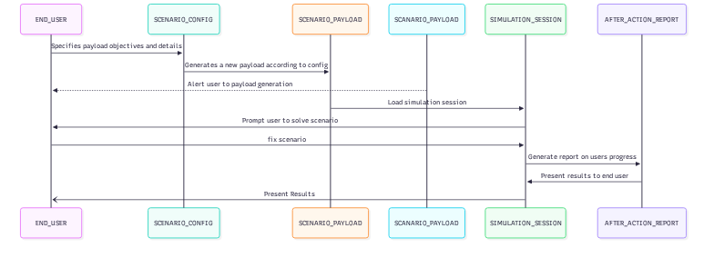
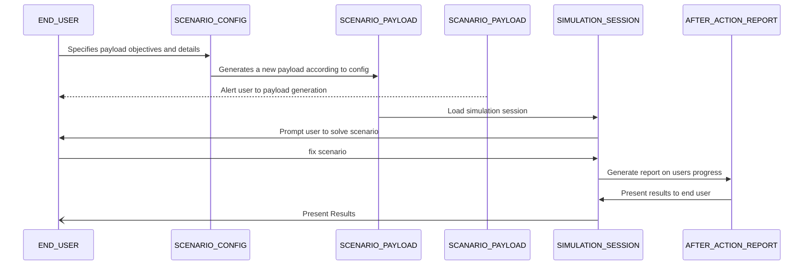

# UML Sequence for Report Flow

* **Epic:** Issue #22 (Develop an interactive and secure cybersecurity training environment), Issue #23 (AI-Driven Cybersecurity Incident-Response Training Simulator)
* **Design Task:** Issue #57 (UML sequence diagram for critical scenario flow)
* **User Stories / Objectives:** #24, #25, #26, #27, #28, #29, #30, #31, #32

## Overview
This document specifies the sequence between the AI Wrapper, the scenario_config, Simulation_Session, Scenatio_Payload, and After_Action_Report classes in order to generate and release a payload into the simulation environment

## Mermaid Source

