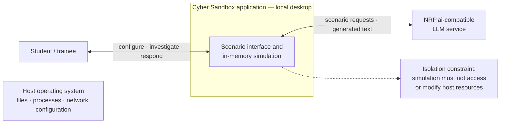

# Design — System context

> Epics: #22, #23 · Task: #54
> Scope: local desktop application, student, NRP.ai-compatible service, and protected host operating system

## What this diagram answers

This context diagram defines the Cyber Sandbox boundary and its external
entities. The student interacts with the local application, which may exchange
scenario requests and generated text with an external NRP.ai-compatible
service. Scenario state and action history remain in the application's
in-memory simulation; there is no external database. The host operating system
is outside the application boundary and must not be accessed or modified by
simulated activity.

The diagram is a system-level view, not a component design. Figure 1 describes
the application's internal layers and safety boundaries, Figure 3 follows the
scenario data flow, and Figures 4 and 5 describe the data model and the
scenario interaction sequence.

## Mermaid source

## External entities and boundaries

- **Student / trainee:** Selects scenario parameters, investigates simulated
  evidence, and performs incident-response actions through the desktop UI.
- **NRP.ai-compatible LLM service:** An optional external service that receives
  scenario-generation or feedback requests and returns generated text/data.
  Returned scenario data is untrusted until validated inside the application.
- **Host operating system:** Outside the application boundary. Simulated files,
  processes, and network activity are application data; simulation behavior
  must not manipulate real host resources. This invariant still requires
  implementation and test evidence.
- **In-memory simulation:** Scenario state and action history are held within
  the application for the prototype. Persistent databases and production
  hosting are outside the current design scope.
