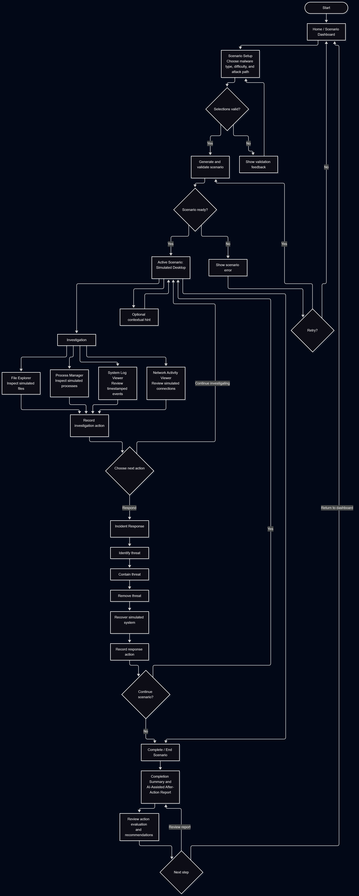
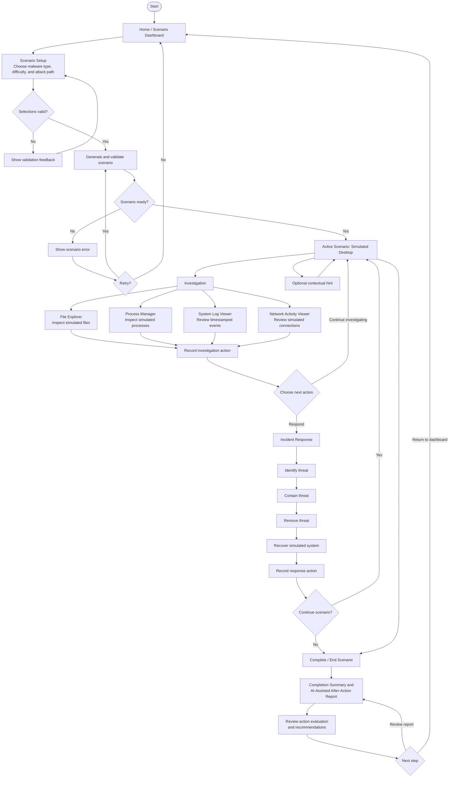

# User Flow / Screen-Flow Diagram

* **Epic:** Issue #23 (AI-Driven Cybersecurity Incident-Response Training Simulator)
* **Design Task:** Issue #58 (User flow diagram for game loop and desktop screens)
* **User Stories / Objectives:** #24 (Obj 1.1), #28 (Obj 1.5), #31 (Obj 1.8), #32 (Obj 1.9), #33 (Obj 2.1), #37 (Obj 2.5), #38 (Obj 2.6), #39 (Obj 2.7), #40 (Obj 2.8)

## Overview

This document models the trainee's path through the Cyber-Squad Incident-Response Training Simulator: starting a scenario, investigating on the simulated desktop, performing incident-response actions, and reaching the completion and after-action report screens.

**Figure 6:** User flow from scenario setup through investigation actions, incident-response actions, and scenario completion with the after-action report.

## Mermaid Source

## Legend & Notation

* **Stadium Node `([ ])`:** Entry point of the flow.
* **Rectangle `[ ]`:** Screen or user/system step.
* **Diamond `{ }`:** Decision point or validation gate.
* **Solid Arrow `-->`:** Screen transition; labeled arrows show the user choice or condition.

## Story & Objective Traceability

* **Objective 2.1 (#33):** `Scenario Setup` collects malware type, difficulty, and attack path.
* **Objective 2.5 (#37):** `Active Scenario: Simulated Desktop` is loaded once the scenario is validated.
* **Objective 1.1 (#24) & 1.5 (#28):** `Investigation` covers the file explorer, process manager, system log viewer, and network activity viewer.
* **Objective 2.6 (#38):** `Record investigation action` and `Record response action` log user actions.
* **Objective 2.8 (#40):** `Optional contextual hint` is available during an active scenario.
* **Objective 1.8 (#31):** `Incident Response` covers identify, contain, remove, and recover.
* **Objective 1.9 (#32):** `Complete / End Scenario` and the return to `Home / Scenario Dashboard` support scenario completion and restart.
* **Objective 2.7 (#39):** `Completion Summary and AI-Assisted After-Action Report` summarizes and evaluates the session.
