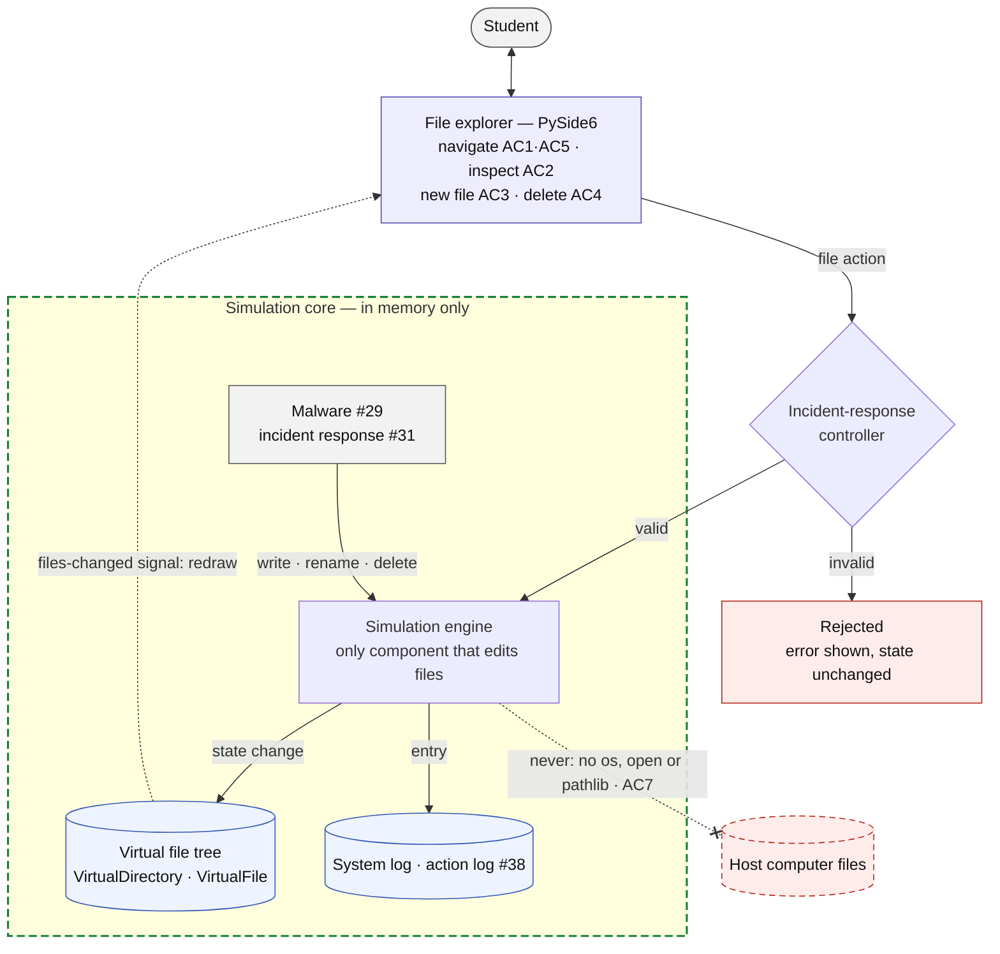
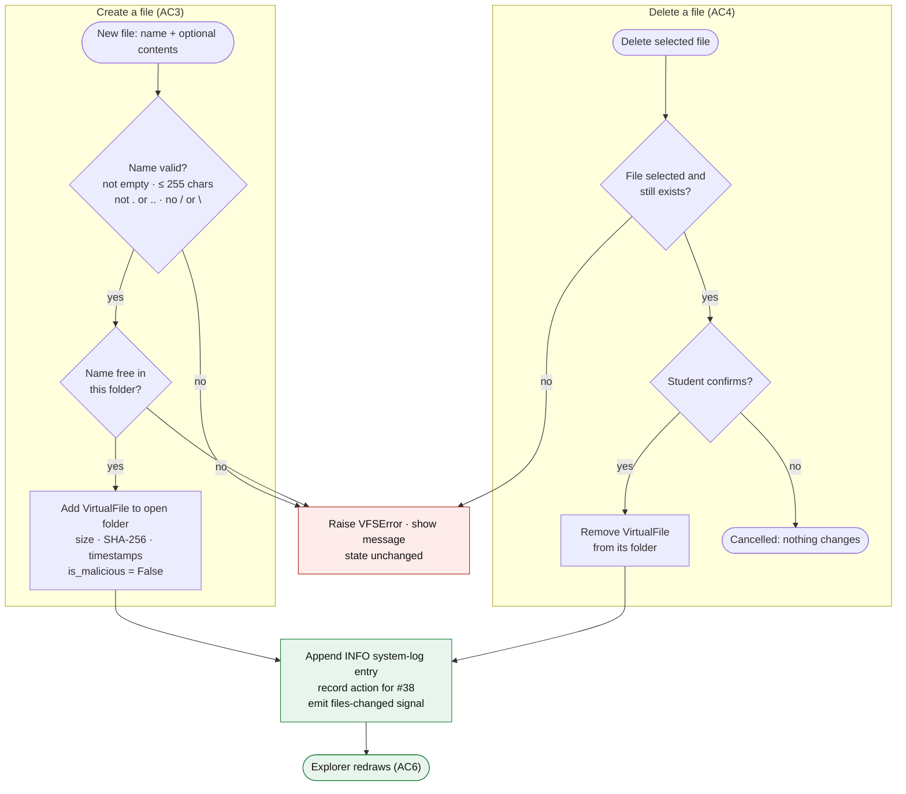

# Design — Virtual file system

> Epic: #22 · Stories: #25
> Owner: alexgoodson-1991 · Sprint: TBD · Status: draft
> Specification: [`../specs/training-environment.md`](../specs/training-environment.md) FR-3, FR-4, FR-5

## Summary

An in-memory folder tree the student can browse, open files in, add files to,
and delete files from. Nothing touches the real computer. Tags like **[AC3]**
point to the acceptance criteria on #25.

## Diagrams

*Figure 7 — Virtual file system component flow. Green dashed box: the
host-isolation boundary (everything stays in memory). Dotted arrow: the
files-changed signal that redraws the explorer. The arrow ending in an X is a
forbidden dependency (AC7).*

*Figure 8 — Create and delete operations (capabilities 5 and 6). Every
rejection goes to the same red box, which changes nothing. Both successful
paths end in the same logging and redraw step.*

### Mermaid source

The exported images are generated from these sources. Edit a block, then
re-export the matching image in `images/` (for example at
[mermaid.live](https://mermaid.live) or with `mmdc -i <file> -o <image>`).

Figure 7:

Figure 8:

## Capabilities

### 1. Store the file tree in memory **[AC7]**

- Two classes in plain Python (no PySide6, no `os`/`pathlib`):
  `VirtualDirectory` (name, children) and `VirtualFile` (fields below).
- Unix-style paths from a single root `/`. Paths are just strings and are never
  passed to the OS.
- Lives in the simulated system state. Only the simulation engine changes it
  ([architecture.md §3](architecture.md)).

### 2. Load the starting tree

- Built from the scenario's file list by the scenario loader (#37). Missing
  parent folders are created automatically.
- Until #34 and #37 land, load a hand-written fixture:
  `/home/student/{Desktop,Documents,Downloads}`, `/etc`, `/var/log`, `/tmp`
  with 8–10 sample files.
- Restart and reset rebuild the tree from the same source (NFR-4, #32).

### 3. Show and navigate folders **[AC1] [AC5]**

- The explorer opens at `/home/student` and lists folders first, then files,
  A→Z.
- Columns: Name · Type (Folder or extension) · Size · Modified.
- Double-click a folder to enter it. The Up button goes to the parent and is
  disabled at `/`. A path bar shows the current location.
- An empty folder shows "This folder is empty."

### 4. Inspect a file **[AC2]**

- Selecting a file fills a side panel with read-only contents plus name, full
  path, size, SHA-256, created and modified.
- If `is_binary`, show "Binary file — contents not viewable" instead of the
  contents. Metadata is still shown.
- Each inspect is recorded as a `FILE_INSPECT` action for the action log (#38).

### 5. Create a file **[AC3] [AC6]**

- "New File" button opens a dialog for a name and optional text contents. The
  file is created in the folder currently open.
- Reject with a message and change nothing if the name is empty, longer than
  255 characters, is `.` or `..`, contains `/` or `\`, or already exists in
  that folder.
- On success: size, hash and timestamps are set, `is_malicious = False`, the
  explorer refreshes with the new file selected, and an INFO entry is added to
  the system log (FR-10).

### 6. Delete a file **[AC4] [AC6]**

- Select a file, then "Delete" (button or Del key), then confirm. The file is
  removed from its folder.
- The explorer refreshes, the inspect panel clears, an INFO entry is added to
  the system log, and the action is recorded (#38).
- Reject without changes if nothing is selected or the file no longer exists
  (for example, malware already changed it).
- Deletion lasts until restart or reset. Whether deleting a malicious file
  completes an objective is decided by the objective evaluator (#31), not the
  file system.

### 7. Stay in sync with other changes **[AC6]**

- The state emits one "files changed" notification after any change, whether
  it came from the student, malware (#29) or incident response (#31). The
  explorer redraws on it.
- If the open folder no longer exists, jump to the nearest existing parent.

### 8. Methods other components call

- `list_dir(path)` · `get_file(path)` ·
  `create_file(dir, name, contents, is_malicious=False)` · `delete_file(path)`
- Engine-only (not in the UI, needed by ransomware in #29):
  `write_file(path, contents)` and `rename_file(path, new_name)`.
- Invalid calls raise `VFSError(message)` and leave state exactly as it was,
  with no partial changes.

### 9. Prove host isolation **[AC7]**

- The file system module imports none of `os`, `pathlib`, `shutil` or `io`,
  and never calls `open()`.
- pytest patches `builtins.open`, `os.remove`, `os.mkdir` and similar calls to
  fail the test if called, then runs every operation. It also runs inside an
  empty temporary directory and asserts the directory is still empty after.

## File fields

| Field | Type | Notes |
|---|---|---|
| `file_id` | str | UUID. Matches `FILE_ARTIFACT` in [data-model.md](data-model.md). |
| `path` | str | Full virtual path of the parent folder, e.g. `/home/student/Documents` |
| `file_name` | str | Name with extension, e.g. `invoice.pdf` |
| `contents` | str | Text shown on inspect. **New**, not in `FILE_ARTIFACT` yet; raise with #34. |
| `is_binary` | bool | True shows a placeholder instead of contents (`.exe`, `.dll`, `.zip`). **New.** |
| `size_bytes` | int | Text files: `len(contents.encode())`. Binary files: value from the scenario. |
| `file_hash` | str | SHA-256 of contents. Recomputed on every change. |
| `created_at` / `modified_at` | datetime | Simulated clock. Set on create; `modified_at` updated on change. |
| `is_malicious` | bool | Ground truth for grading. Never shown in the UI. |

## Deliverable

Implementation, tests and this design doc, merged through one PR that says
`Closes #25`.

- `prototype/sim/vfs.py`: the in-memory file tree and the methods in
  capability 8. No PySide6, `os`, `pathlib` or `open()`.
- `prototype/ui/file_explorer.py`: PySide6 explorer with navigation, inspect
  panel, New File and Delete; redraws on the change signal.
- `prototype/fixtures/default_filesystem.json`: starter tree used until the
  loader (#37) is ready.
- `prototype/tests/test_vfs.py`: unit tests for each capability and every
  rejection case.
- `prototype/tests/test_vfs_isolation.py`: proves no real files are created,
  changed or deleted (AC7).
- `docs/design/virtual-file-system.md`: this document, with Figures 7 and 8.
- `prototype/README.md`: updated with how to run the explorer and the tests.

## Done when

- pytest covers each capability above, including every rejection case in 5 and
  6, without opening a window.
- All seven acceptance criteria on #25 are checked off by a teammate in the PR
  review.

## Open questions

These are not in the acceptance criteria, so the defaults above are proposals,
not decisions.

| Question | Proposed default | Needed by |
|---|---|---|
| Can students create and delete folders, or only files? | Files only | Before implementation of #25 |
| Can students edit file contents in the UI? | No, read-only | Before implementation of #25 |
| Should `contents` and `is_binary` be added to `FILE_ARTIFACT`? | Yes | Before #34 |
| Unix-style (`/home/student`) or Windows-style (`C:\Users`) paths? | Unix-style | Before implementation of #25 |
| How do components map to folders in `prototype/`? | `sim/`, `ui/`, `fixtures/`, `tests/` ([architecture.md §7](architecture.md) leaves this open) | Before any Goal 1 implementation |
