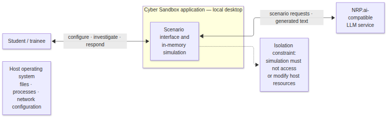
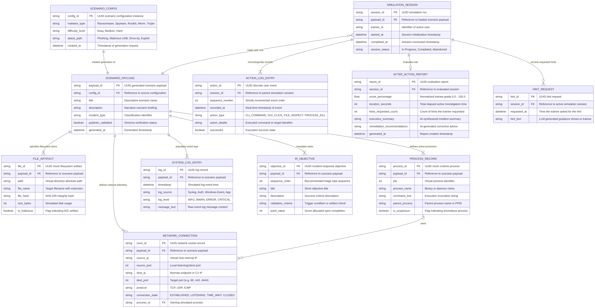
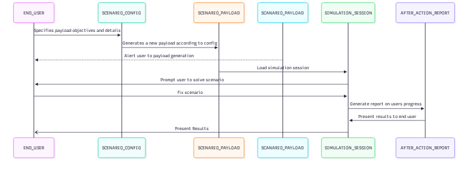
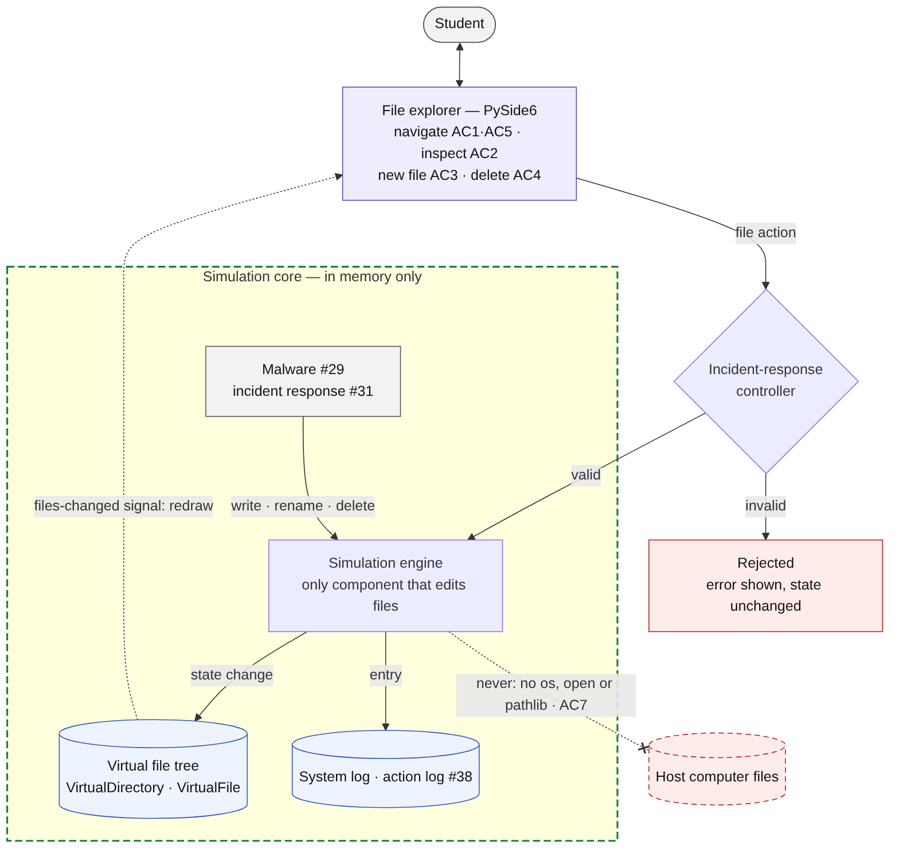
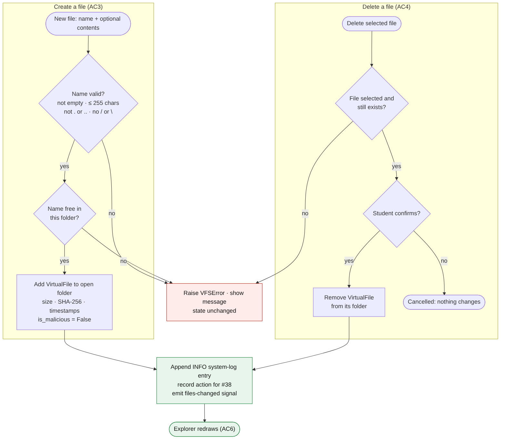

# Project Proposal — Cyber Sandbox

**Department of Computer Science**
**CPSC 490 Undergraduate Seminar in Computer Science — Proposal for Capstone Project**

**Group 14 — Cyber Squad** · Sponsor: independent
Authors: Goodson, Alex (alexgoodson-1991), Boynton, Daniel (danjobo), Nellesen, Jake (Jake-P-N), Nguyen, Vanna (NguyenVGH), Villacorte, Joseph (jvillacorte)
Repository: https://github.com/jvillacorte/CPSC490-G14-Cyber-Squad
Date: 2026-10-15

## 0. Abstract

Cybersecurity education often emphasizes conceptual knowledge, while opportunities for repeated hands-on practice tend to be more limited in scope and practice. Thus, beginner students can benefit from supplemental environments, where they can safely apply what they have learned by practicing responding to threats without risking damage to a real system.

This project proposes a Rogue-Lite Cybersecurity Training sandbox, an AI-assisted learning environment designed for beginner cybersecurity students. The application would be able to simulate a desktop environment, where users interact and investigate files, processes, logs, and network activity associated with malware incidents. The reach of the threats would remain enclosed within the simulated application, allowing users to practice identifying, containing, removing, and recovering from malicious activities in a controlled setting.

A primary feature of this system is the use of artificial intelligence to create variation between training scenarios. An LLM would be given input parameters, such as difficulty level, malware type, and a path of attack, then generate structured scenario data based on predefined guidelines. Pydantic would be used to validate this data before it is incorporated into the simulation. AI may also provide educational explanations and an after-action report describing the entire attack, and giving feedback on the user’s response.

The end goal of this project is to establish a framework for an accessible and continually repeatable cybersecurity training tool that can supplement traditional coursework with something more closely related to an actual cybersecurity event. Python and PySide6 are tentative options to create the simulated desktop interface, while a local/hosted LLM could be utilized through [NRP.ai](https://nrp.ai), which could support the dynamic scenario generation and feedback.

## 1. Introduction

Cybersecurity courses introduce foundational concepts through lectures, readings, and structured labs. Developing incident-response skills also requires repeated practice interpreting evidence, choosing actions, and evaluating their consequences. Exercises involving real malware require careful isolation and setup, which can create additional barriers for beginners. Repeating a fixed exercise can also reward familiarity with its sequence rather than practice adapting an investigation to new evidence.

This proposal presents Cyber Sandbox, a desktop-style training simulator for beginner cybersecurity students. It represents files, processes, logs, and network connections as simulated evidence inside the application; students can inspect that evidence and practice incident-response actions without running real malware. The intended exercise is to investigate a simulated incident and decide how to identify, contain, remove, and recover from the threat.

The longer-term design proposes scenario variation based on selected parameters, with generated scenario data validated before it is loaded into the simulation. A record of student actions could support an after-action report and contextual feedback. The initial prototype is intended to test a small, runnable slice of that design. Whether generated scenarios provide meaningful variation or improve learning remains to be evaluated; those are project goals, not established results.

### 1.1 Related Work

Hands-on cybersecurity training platforms use several formats. TryHackMe offers guided learning paths and labs [1], while Hack The Box Academy organizes training into modules and practical environments [2]. CyberDefenders emphasizes blue-team investigation challenges [3]; LetsDefend offers simulated Security Operations Center (SOC) training [4]; and CyLab Security Academy uses challenge-based learning [5]. These platforms demonstrate complementary ways to teach practical skills; they are not interchangeable products with a single shared scope.

| Existing approach | Documented emphasis | Relation to Cyber Sandbox |
|---|---|---|
| TryHackMe [1] | Guided learning paths and hands-on labs | Cyber Sandbox instead centers on investigating a simulated desktop incident and responding to its artifacts. |
| Hack The Box Academy [2] | Structured training modules and practical cybersecurity environments | Cyber Sandbox has a narrower proposed scope: beginner incident response in one simulated desktop, rather than a broad catalog of technical training. |
| CyberDefenders [3] | Blue-team investigation and forensic challenges | Cyber Sandbox proposes an interactive in-memory system whose simulated files, processes, logs, and connections can change as a student responds. |
| LetsDefend [4] | Simulated SOC training and incident-response workflows | Cyber Sandbox focuses on endpoint-style evidence and desktop-level response actions, rather than a full SOC workflow. |
| CyLab Security Academy [5] | Challenge-based cybersecurity learning | Cyber Sandbox proposes scenario-based incident investigation and response, rather than a capture-the-flag challenge format. |

Cyber Sandbox's proposed distinction is its combination of a desktop-like simulated system, beginner-focused incident-response actions, and parameterized scenario generation. The prototype is planned to keep simulated state in memory rather than use a full cyber-range deployment or virtual-machine image, and to separate that state from host files, processes, and network settings. Generated content would be treated as untrusted input and validated before loading, while recorded actions could inform feedback. This is a focused complement to existing paths, labs, investigation platforms, SOC simulations, and challenges—not a claim that those platforms lack safety, scenario variety, or feedback. The safety boundary, quality of generated scenarios, and educational value of repeated variation still require implementation and evaluation. [[task:#113]](https://github.com/jvillacorte/CPSC490-G14-Cyber-Squad/issues/113)

### 1.2 Problem Statements

P1-  Limited Acceess to Safe, Practical Cybersecurity Training: Beginning cybersecurity students need the opportunity to apply their foundational knowledge to practical security events, but providing hands-on malware exercuses can present challenges with safety and environment configuration depending on the level of experience the student has. Working with real malware requires carefully isolated environments and additional security precautions in order to prevent unintended effects on the host system.

P2- Limited Scenario Variation and ability for Repeated Learning Opportunities: Predetermined cybersecurity training scenarios may become less effective upon repetition, as students can become familiar witht he overall structure, expected events, and where to find the answers without actually training any practical experience. This can limit opportunities for students to practice adapting their skills to unfamiliar threats and situations when the time requires.

| Problem | Addressed by |
|---|---|
| P1 Limited access to safe and practical cybersecurity training | Goal 1: Develop an interactive and secure cybersecurity training environment (#22) |
| P2 Limited scenario variation and opportunities for repeated learning experiences | Goal 2: Integrate AI-assisted mechanics through scenario generation and custom-generated feedback (#23) |

## 2. Goals and Objectives

- **Goal 1: Develop an interactive and secure cybersecurity training environment** (Epic [[epic:#22]](https://github.com/jvillacorte/CPSC490-G14-Cyber-Squad/issues/22))
  - Objective 1.1: Create a simulated desktop interface that contains a file explorer, process manager, system log viewer, and network activity viewer. ([[story:#24]](https://github.com/jvillacorte/CPSC490-G14-Cyber-Squad/issues/24))
  - Objective 1.2: Implement a virtual file system that allows users to inspect, create, and delete simulated files. ([[story:#25]](https://github.com/jvillacorte/CPSC490-G14-Cyber-Squad/issues/25))
  - Objective 1.3: Create a process manager for the desktop environment that allows users to inspect and terminate running simulated programs and processes. ([[story:#26]](https://github.com/jvillacorte/CPSC490-G14-Cyber-Squad/issues/26))
  - Objective 1.4: Develop a system log viewer that displays timestamped events associated with the simulated system, including malware activity. ([[story:#27]](https://github.com/jvillacorte/CPSC490-G14-Cyber-Squad/issues/27))
  - Objective 1.5: Develop a network activity viewer that displays simulated connections, including source and destination addresses, ports, and connection status. ([[story:#28]](https://github.com/jvillacorte/CPSC490-G14-Cyber-Squad/issues/28))
  - Objective 1.6: Implement at least two simulated malware behaviors that modify simulated files, processes, and network activity while restricting their effects to the internal application. ([[story:#29]](https://github.com/jvillacorte/CPSC490-G14-Cyber-Squad/issues/29))
  - Objective 1.7: Verify through separate test cases that each simulated malware behavior does not modify host-system files, processes, or network configurations. ([[story:#30]](https://github.com/jvillacorte/CPSC490-G14-Cyber-Squad/issues/30))
  - Objective 1.8: Implement incident-response controls that allow users to identify, contain, remove, and recover from simulated malware threats. ([[story:#31]](https://github.com/jvillacorte/CPSC490-G14-Cyber-Squad/issues/31))
  - Objective 1.9: Implement scenario controls that allow users to start, complete, restart, and reset training scenarios. ([[story:#32]](https://github.com/jvillacorte/CPSC490-G14-Cyber-Squad/issues/32))

- **Goal 2: Integrate AI-assisted mechanics through scenario generation and custom-generated feedback** (Epic [[epic:#23]](https://github.com/jvillacorte/CPSC490-G14-Cyber-Squad/issues/23))
  - Objective 2.1: Develop a scenario configuration interface that allows users to select malware type, difficulty level (easy, medium, or hard), and attack path. ([[story:#33]](https://github.com/jvillacorte/CPSC490-G14-Cyber-Squad/issues/33))
  - Objective 2.2: Define a structured scenario schema containing simulated files, processes, logs, network activity, and incident-response objectives. ([[story:#34]](https://github.com/jvillacorte/CPSC490-G14-Cyber-Squad/issues/34))
  - Objective 2.3: Integrate an LLM through [NRP.ai](https://nrp.ai) to generate structured cybersecurity scenarios based on user-selected parameters. ([[story:#35]](https://github.com/jvillacorte/CPSC490-G14-Cyber-Squad/issues/35))
  - Objective 2.4: Implement Pydantic validation that accepts scenarios meeting predefined requirements and rejects scenarios containing invalid or unsupported data. ([[story:#36]](https://github.com/jvillacorte/CPSC490-G14-Cyber-Squad/issues/36))
  - Objective 2.5: Implement a scenario loader that converts validated AI-generated data into interactive elements within the simulated desktop environment. ([[story:#37]](https://github.com/jvillacorte/CPSC490-G14-Cyber-Squad/issues/37))
  - Objective 2.6: Develop an action-logging system that records user investigation and incident-response actions in chronological order. ([[story:#38]](https://github.com/jvillacorte/CPSC490-G14-Cyber-Squad/issues/38))
  - Objective 2.7: Generate an AI-assisted after-action report that summarizes the simulated attack information, evaluates user actions, and recommends alternative incident-response procedures. ([[story:#39]](https://github.com/jvillacorte/CPSC490-G14-Cyber-Squad/issues/39))
  - Objective 2.8: Implement an optional AI-assisted hint system that provides contextual information during an active training scenario. ([[story:#40]](https://github.com/jvillacorte/CPSC490-G14-Cyber-Squad/issues/40))
  - Objective 2.9: Generate at least three distinct and structurally valid scenarios using identical input parameters to demonstrate scenario variability, and test three additional scenarios using different input parameters. ([[story:#41]](https://github.com/jvillacorte/CPSC490-G14-Cyber-Squad/issues/41))

## 3. Proposed Approaches

Our project proposes an **in-memory cybersecurity simulation** to train beginner incident-response skills.

Instead of manipulating host operating-system resources, the application is intended to model files, processes, system logs, and network activity inside application state. This design aims to make training repeatable and prevent accidental harm to the user's machine while allowing realistic investigation and response workflows; the isolation behavior still requires implementation and testing.

For scenario generation, we will combine **user-selected parameters** (malware type, difficulty, attack path) with an LLM integration to produce structured scenario data. Because LLM output can be inconsistent, generated scenarios are treated strictly as data and must pass schema validation before they can be loaded into the training environment. This design reduces unsafe or malformed outputs while preserving scenario variability.

We selected this approach over static handcrafted scenarios because it supports repeated practice with varied incidents and stronger learning transfer. We also selected this approach over host-level sandbox execution because Sprint 2 priorities are specification, design clarity, and a reliable prototype skeleton, not high-risk runtime behavior. Detailed implementation choices, environment/tooling, and diagram artifacts are documented in §4.

## 4. Required Environment, Resources, and Planned Activities

### Environment and resources

The planned implementation uses Python 3.x, PySide6 for the desktop interface, and Pydantic for scenario validation. Python supports rapid development of the in-memory simulation and its AI integration; PySide6 provides a desktop-style interface, while Pydantic can reject malformed scenario data before it is loaded. Development and demonstrations are intended to run locally on Python-supported Windows, macOS, and Linux machines, avoiding production deployment complexity while enabling repeatable clean-clone runs. These are design choices, not claims that the prototype already runs on all three platforms. [[task:#59]](https://github.com/jvillacorte/CPSC490-G14-Cyber-Squad/issues/59) [[task:#93]](https://github.com/jvillacorte/CPSC490-G14-Cyber-Squad/issues/93)

The prototype is intended to keep simulation state in memory, with optional file-based fixtures for test scenarios. This supports reset and restart without deliberately modifying host files, processes, or network settings; isolation still needs to be verified by tests. The project is independent, requires no sponsor dataset, and plans to use local machines rather than production hosting for the prototype. These choices reduce external dependencies while the team validates the simulation design. [[task:#60]](https://github.com/jvillacorte/CPSC490-G14-Cyber-Squad/issues/60)

For AI-assisted generation and feedback, the team plans to use an NRP.ai-compatible LLM endpoint with an account and API key supplied through environment variables. A local `.env` file and a checked-in `.env.example` without real secrets are planned to make configuration reproducible without committing credentials; the example file and integration are not yet present. The integration spike will evaluate generation and validation before scenario data enters the simulation. [[task:#79]](https://github.com/jvillacorte/CPSC490-G14-Cyber-Squad/issues/79)

GitHub Issues and Projects, pull requests, GitHub Actions, `check_repo.py`, and the sprint-report workflow support traceability and review of the work described in §3. The planned test tool is `pytest`, with tests in `prototype/tests` for schema validation and host isolation. Those tests are still to be implemented; the current prototype CI can pass without collecting any tests. [[task:#83]](https://github.com/jvillacorte/CPSC490-G14-Cyber-Squad/issues/83) [[task:#60]](https://github.com/jvillacorte/CPSC490-G14-Cyber-Squad/issues/60)

### Diagrams

Figure references in this section correspond to design artifacts in `docs/design/`.

- **Figure 1. High-level architecture diagram** — [docs/design/architecture.md](../docs/design/architecture.md)

  Figure 1 shows the three planned layers of the application: a PySide6 presentation layer, an in-memory simulation core, and an AI integration layer. It also marks two intended safety boundaries: simulated operations stay within in-memory state rather than modifying host resources, and NRP.ai output must pass Pydantic validation before the scenario loader can place it in the simulation [[task:#53]](https://github.com/jvillacorte/CPSC490-G14-Cyber-Squad/issues/53).

  
  *Figure 1: High-level architecture showing the presentation layer, the AI integration layer with its untrusted-data boundary, and the in-memory simulation core with its host-isolation boundary.*

- **Figure 2. System context diagram** — [docs/design/system-context.md](../docs/design/system-context.md)

  Figure 2 defines the application boundary: the student interacts with the local Cyber Sandbox, which may exchange requests and generated content with an external NRP.ai-compatible service. The host operating system is outside the boundary and must not be accessed or changed by simulated activity; scenario state and action history are in memory, not in an external database. This context view complements Figure 1's internal component layers, Figure 3's data flow, Figure 4's scenario and action-log entities, and Figure 5's interaction sequence [[task:#54]](https://github.com/jvillacorte/CPSC490-G14-Cyber-Squad/issues/54).

  
  *Figure 2: System context and external boundaries. The application exchanges scenario data with the student and optional LLM service; simulated activity remains separate from host operating-system resources.*

- **Figure 3. Data flow diagram** — [docs/design/data-flow.md](../docs/design/data-flow.md)

  Figure 3 illustrates the end-to-end data lifecycle, detailing external inputs, internal transformations across NRP.ai and Pydantic validation boundaries, and in-memory action logging and reporting.

  
  *Figure 3: System Data Flow Diagram modeling parameter input through generation, validation, desktop loading, chronological action logging, and after-action reporting.*

- **Figure 4. ER diagram for scenario schema and action logs** — [docs/design/data-model.md](../docs/design/data-model.md)

  Figure 4 opens up the data held inside the Cyber Sandbox box of the system context diagram (Figure 2). A scenario configuration (malware type, difficulty and attack path) initiates one scenario payload, which defines the simulated files, processes, network connections, system log entries and incident-response objectives the student investigates. A simulation session loads that payload and records the student's actions in order, the hints they request, and the after-action report that evaluates the session [[task:#56]](https://github.com/jvillacorte/CPSC490-G14-Cyber-Squad/issues/56).

  
  *Figure 4: Entity-relationship diagram linking the scenario configuration and payload (files, processes, network connections, log entries and objectives) to the simulation session, its action log, hint requests and after-action report.*

- **Figure 5. Sequence diagram for critical scenario flow** — [docs/design/scenario-sequence.md](../docs/design/scenario-sequence.md)

  Figure 5 traces one scenario over time across the boundary that Figure 2 draws between the user and the Cyber Sandbox. The user's configuration goes to the application controller, which has the scenario generator create a scenario; the Pydantic validator checks it and the scenario loader hands it back before the simulation engine builds the simulated desktop. The user then works the challenge on the desktop, the incident-response controller checks each action, and the after-action report generator returns the results to the user [[task:#57]](https://github.com/jvillacorte/CPSC490-G14-Cyber-Squad/issues/57).

  
  *Figure 5: Sequence from scenario configuration through generation, validation and loading to the simulated desktop challenge, incident-response checks and the after-action report.*

- **Figure 6. User flow / screen-flow diagram** — [docs/design/user-flow.md](../docs/design/user-flow.md)

  Figure 6 shows the trainee's path from scenario setup through investigation and incident-response actions to scenario completion and the after-action report.

  
  *Figure 6: User flow diagram covering scenario start, investigation actions, response actions, and completion/report flow.*

- **Figure 7. Virtual file system component flow** — [docs/design/virtual-file-system.md](../docs/design/virtual-file-system.md)

  Figure 7 shows how a student's file action travels from the file explorer through the incident-response controller to the simulation engine, the only component that edits the in-memory file tree. Malware and incident-response actions use the same path, a change signal redraws the explorer, and nothing reaches host files [[task:#99]](https://github.com/jvillacorte/CPSC490-G14-Cyber-Squad/issues/99).

  
  *Figure 7: Virtual file system component flow showing the explorer, the incident-response controller, the in-memory simulation core and the forbidden path to host files.*

- **Figure 8. Create and delete file operations** — [docs/design/virtual-file-system.md](../docs/design/virtual-file-system.md)

  Figure 8 shows the checks for creating and deleting a simulated file, the shared rejection path that leaves state unchanged, and the logging and redraw step that follows every successful change [[task:#99]](https://github.com/jvillacorte/CPSC490-G14-Cyber-Squad/issues/99).

  
  *Figure 8: Create and delete operations with their validation checks, rejection path, and logging and redraw step.*

### Specification and design documents

| Document | Kind | Covers | Issues |
|---|---|---|---|
| [docs/specs/training-environment.md](../docs/specs/training-environment.md) | specification | Goal 1 requirements for the interactive, secure training environment | [[task:#46]](https://github.com/jvillacorte/CPSC490-G14-Cyber-Squad/issues/46), [[feature:#101]](https://github.com/jvillacorte/CPSC490-G14-Cyber-Squad/issues/101) | |
| [docs/specs/ai-scenarios.md](../docs/specs/ai-scenarios.md) | specification | Goal 2 requirements for AI-assisted scenario generation and feedback | [[task:#47]](https://github.com/jvillacorte/CPSC490-G14-Cyber-Squad/issues/47) |
| [docs/design/architecture.md](../docs/design/architecture.md) | design | High-level architecture and component boundaries | [[task:#53]](https://github.com/jvillacorte/CPSC490-G14-Cyber-Squad/issues/53), [[task:#70]](https://github.com/jvillacorte/CPSC490-G14-Cyber-Squad/issues/70) |
| [docs/design/system-context.md](../docs/design/system-context.md) | design | System boundary and external actors/services | [[task:#54]](https://github.com/jvillacorte/CPSC490-G14-Cyber-Squad/issues/54) |
| [docs/design/data-flow.md](../docs/design/data-flow.md) | design | Data flow from user input through AI generation, validation, loading, and reporting | [[task:#55]](https://github.com/jvillacorte/CPSC490-G14-Cyber-Squad/issues/55) |
| [docs/design/data-model.md](../docs/design/data-model.md) | design | ER/data model for scenario schema and action logs | [[task:#56]](https://github.com/jvillacorte/CPSC490-G14-Cyber-Squad/issues/56) |
| [docs/design/scenario-sequence.md](../docs/design/scenario-sequence.md) | design | Sequence flow across configure/generate/validate/load/play/report | [[task:#57]](https://github.com/jvillacorte/CPSC490-G14-Cyber-Squad/issues/57) |
| [docs/design/user-flow.md](../docs/design/user-flow.md) | design | User flow/game-loop and screen transitions | [[task:#58]](https://github.com/jvillacorte/CPSC490-G14-Cyber-Squad/issues/58) |
| [docs/design/virtual-file-system.md](../docs/design/virtual-file-system.md) | design | Capabilities, component flow and file operations for the in-memory virtual file system | [[task:#99]](https://github.com/jvillacorte/CPSC490-G14-Cyber-Squad/issues/99) |

#### Document summaries

`docs/specs/training-environment.md` defines the Goal 1 requirements for the simulated desktop training environment, including functional behavior for file/process/log/network views, malware simulation, incident-response controls, and scenario lifecycle actions. It explicitly defines in-scope and out-of-scope behavior and formalizes host isolation as a core safety constraint. The specification also provides acceptance criteria and open questions to guide implementation and testing work linked to Goal 1 stories.

The specification also contains a dedicated section for the network activity viewer (Objective 1.5), which turns the general requirements FR-11 to FR-13 into a specification that can be implemented directly in CPSC 491. It defines what a simulated connection contains: the five columns shown in the connection list, the protocol, connection ID, direction and owning process shown when a connection is selected, the three supported protocols, and the four connection states, including the CLOSED state that containment actions produce. It then breaks FR-11, FR-12 and FR-13 into sixteen detailed requirements covering how connections are displayed, how the display updates when connections are created or change state, how connections generated by simulated malware reach the viewer through a single network event from the malware behavior engine, and what the viewer must never do to the host computer's network. Finally, it restates each of the story's six acceptance criteria with a concrete check and the automated test or manual verification planned for implementation. [[feature:#101]](https://github.com/jvillacorte/CPSC490-G14-Cyber-Squad/issues/101) [[task:#102]](https://github.com/jvillacorte/CPSC490-G14-Cyber-Squad/issues/102) [[task:#103]](https://github.com/jvillacorte/CPSC490-G14-Cyber-Squad/issues/103) [[task:#104]](https://github.com/jvillacorte/CPSC490-G14-Cyber-Squad/issues/104)

`docs/specs/ai-scenarios.md` defines the Goal 2 requirements for scenario configuration, AI generation, validation, loading, action logging, after-action reporting, hinting, and variability testing. It treats AI output as structured data and requires validation before loading to preserve reliability and safety. The document provides objective-traceable functional and non-functional requirements with acceptance criteria aligned to Goal 2 stories.

`docs/design/architecture.md` documents the high-level component structure of the system and the trust boundaries between UI, simulation core, AI integration, validation, and reporting paths. It explains how components communicate and where responsibilities are separated to preserve host isolation. This serves as the primary structural reference for prototype folder layout and implementation planning.

`docs/design/system-context.md` shows what is inside the Cyber Sandbox system boundary and what remains external, including users and external AI services. It clarifies interface points and dependency edges that affect reliability, security, and operational assumptions. This context diagram anchors environmental/resource decisions and reduces ambiguity about integration scope.

`docs/design/data-flow.md` describes how scenario data moves from user-selected parameters through AI generation, validation, loading into simulation state, and onward into logs/reports. It identifies transformations, checkpoints, and failure points where invalid data must be rejected safely. This flow supports test planning and traceability for Goal 2 behaviors.

`docs/design/data-model.md` captures the conceptual entities and relationships needed for scenario definitions and action-history records used in evaluation/reporting. It defines core data structures that should remain consistent across generation, validation, simulation, and analysis steps. The model supports consistency in both implementation and test-case design.

`docs/design/scenario-sequence.md` details the temporal interaction sequence among system components during the critical scenario lifecycle. It clarifies when each subsystem is called, what responses are expected, and where validation/failure handling occurs. This sequence reference reduces integration ambiguity and informs interface contract decisions.

`docs/design/user-flow.md` describes the end-user flow through configuration, scenario execution, investigation/response actions, and completion/reporting. It maps major screens/states and transitions to ensure usability and alignment with learning objectives. This document helps ensure that UI behavior remains consistent with both Goal 1 functionality and Goal 2 AI-assisted workflows.

`docs/design/virtual-file-system.md` defines the capabilities of the simulated file system for Objective 1.2: loading, navigating, inspecting, creating and deleting files, all held in memory. It lists the fields each simulated file carries, the methods other components call, and the inputs that are rejected without changing state. Figures 7 and 8 show how file actions pass through the simulation core and how create and delete reject bad input. It also describes how host isolation is tested and which files make up the deliverable, so the objective can be implemented and verified without open questions.

### Planned activities — the work items

This subsection walks through the tasks that carry out the goals and objectives in §2. The epics and user stories themselves are linked in §2; only task-type work items are cited here. The paragraphs are grouped by purpose and, within each group, by sprint, and each one names the owner, the sprint, and the goal the task serves.

**Requirements and specifications.** In Sprint 2, jvillacorte turned each goal into a written requirements list. Creating the requirements list for Goal 1 ([[task:#46]](https://github.com/jvillacorte/CPSC490-G14-Cyber-Squad/issues/46)) serves Goal 1, the interactive and secure training environment, and produced `docs/specs/training-environment.md`. Creating the requirements list for Goal 2 ([[task:#47]](https://github.com/jvillacorte/CPSC490-G14-Cyber-Squad/issues/47)) serves Goal 2, the AI-assisted scenario mechanics, and produced `docs/specs/ai-scenarios.md`.

**Design diagrams.** Sprint 2 produced most of the design figures in this section. danjobo drew the high-level architecture diagram ([[task:#53]](https://github.com/jvillacorte/CPSC490-G14-Cyber-Squad/issues/53)), Figure 1, which serves both Goal 1 and Goal 2 by fixing the layers and safety boundaries shared by the whole system. alexgoodson-1991 drew the data flow diagram for scenario generation and evaluation ([[task:#55]](https://github.com/jvillacorte/CPSC490-G14-Cyber-Squad/issues/55)), Figure 3, which serves Goal 2. NguyenVGH drew the ER diagram for the scenario schema and action logs ([[task:#56]](https://github.com/jvillacorte/CPSC490-G14-Cyber-Squad/issues/56)), Figure 4, which also serves Goal 2. Jake-P-N drew the UML sequence diagram for the critical scenario flow ([[task:#57]](https://github.com/jvillacorte/CPSC490-G14-Cyber-Squad/issues/57)), Figure 5, which serves Goals 1 and 2 because the flow crosses both the desktop and the AI pipeline. jvillacorte drew the user flow diagram for the game loop and desktop screens ([[task:#58]](https://github.com/jvillacorte/CPSC490-G14-Cyber-Squad/issues/58)), Figure 6, which serves Goal 1. In Sprint 3, NguyenVGH completed the system context diagram for Cyber Sandbox ([[task:#54]](https://github.com/jvillacorte/CPSC490-G14-Cyber-Squad/issues/54)), Figure 2, which serves Goals 1 and 2 by drawing the boundary between the application and its users and external AI service. alexgoodson-1991 completed the virtual file system design doc ([[task:#99]](https://github.com/jvillacorte/CPSC490-G14-Cyber-Squad/issues/99)), which defines the design behind Figures 7 and 8 for Objective 1.2.

**Network activity viewer.** For Objective 1.5, the team specified the network activity viewer ([[feature:#101]](https://github.com/jvillacorte/CPSC490-G14-Cyber-Squad/issues/101)) by defining connection fields, protocols, states, and details ([[task:#102]](https://github.com/jvillacorte/CPSC490-G14-Cyber-Squad/issues/102)), expanding the functional requirements ([[task:#103]](https://github.com/jvillacorte/CPSC490-G14-Cyber-Squad/issues/103)), and making its acceptance criteria testable ([[task:#104]](https://github.com/jvillacorte/CPSC490-G14-Cyber-Squad/issues/104)). The team is now designing the viewer ([[feature:#105]](https://github.com/jvillacorte/CPSC490-G14-Cyber-Squad/issues/105)) by documenting component responsibilities ([[task:#106]](https://github.com/jvillacorte/CPSC490-G14-Cyber-Squad/issues/106)), connection-state transitions ([[task:#107]](https://github.com/jvillacorte/CPSC490-G14-Cyber-Squad/issues/107)), the screen wireframe ([[task:#108]](https://github.com/jvillacorte/CPSC490-G14-Cyber-Squad/issues/108)), design decisions and rejected alternatives ([[task:#109]](https://github.com/jvillacorte/CPSC490-G14-Cyber-Squad/issues/109)), and what remains undesigned ([[task:#110]](https://github.com/jvillacorte/CPSC490-G14-Cyber-Squad/issues/110)).

**Proposal writing.** In Sprint 2, jvillacorte wrote §3, proposed approaches ([[task:#61]](https://github.com/jvillacorte/CPSC490-G14-Cyber-Squad/issues/61)), and NguyenVGH wrote the §4 environment and resources ([[task:#59]](https://github.com/jvillacorte/CPSC490-G14-Cyber-Squad/issues/59)); both serve Goals 1 and 2 by explaining how the whole system will be built. In Sprint 3 the writing turns to finishing the proposal. The team has tasks for the spring implementation timeline in §6 ([[task:#80]](https://github.com/jvillacorte/CPSC490-G14-Cyber-Squad/issues/80)), the project development plan ([[task:#84]](https://github.com/jvillacorte/CPSC490-G14-Cyber-Squad/issues/84)), the outcomes and AI disclosure in §§5 and 7 ([[task:#82]](https://github.com/jvillacorte/CPSC490-G14-Cyber-Squad/issues/82)), report draft #1 ([[task:#81]](https://github.com/jvillacorte/CPSC490-G14-Cyber-Squad/issues/81)), a sourced comparison in §§1 and 1.1 ([[task:#113]](https://github.com/jvillacorte/CPSC490-G14-Cyber-Squad/issues/113)), and the requirements and design narrative for §4 ([[task:#112]](https://github.com/jvillacorte/CPSC490-G14-Cyber-Squad/issues/112)). The §4 environment-and-resources prose task ([[task:#93]](https://github.com/jvillacorte/CPSC490-G14-Cyber-Squad/issues/93)) and planned-activities prose task ([[task:#94]](https://github.com/jvillacorte/CPSC490-G14-Cyber-Squad/issues/94)) are complete; the reference-completion task is also complete ([[task:#83]](https://github.com/jvillacorte/CPSC490-G14-Cyber-Squad/issues/83)).

**Word export.** The team updated the course converter and proposal paragraph formatting so the Word submission uses the template and groups issue references in its appendix ([[task:#97]](https://github.com/jvillacorte/CPSC490-G14-Cyber-Squad/issues/97)). Regenerate the Word file after the latest proposal edits, visually review it, and replace the remaining proposal placeholders before submission.

**Prototype.** In Sprint 3, Jake-P-N's task covers the prototype skeleton and smoke run for the demo ([[task:#60]](https://github.com/jvillacorte/CPSC490-G14-Cyber-Squad/issues/60)). The team also has a spike to request structured scenario data from the AI endpoint and validate it before loading ([[task:#79]](https://github.com/jvillacorte/CPSC490-G14-Cyber-Squad/issues/79)). Separate test tasks cover scenario validation ([[task:#114]](https://github.com/jvillacorte/CPSC490-G14-Cyber-Squad/issues/114)) and host isolation ([[task:#115]](https://github.com/jvillacorte/CPSC490-G14-Cyber-Squad/issues/115)). The repository currently contains a prototype README, an empty dependency list, and a TODO Dockerfile, but no runnable simulation or tests.

**Process and alignment.** In Sprint 2, the team reviewed diagram tasks and priorities ([[task:#44]](https://github.com/jvillacorte/CPSC490-G14-Cyber-Squad/issues/44)), set the project vision and task distribution ([[task:#45]](https://github.com/jvillacorte/CPSC490-G14-Cyber-Squad/issues/45)), and backfilled story metadata and typed references ([[task:#62]](https://github.com/jvillacorte/CPSC490-G14-Cyber-Squad/issues/62)). In Sprint 3, danjobo aligned the data model and data flow with the architecture and marked spec questions addressed by those decisions ([[task:#70]](https://github.com/jvillacorte/CPSC490-G14-Cyber-Squad/issues/70), [[task:#72]](https://github.com/jvillacorte/CPSC490-G14-Cyber-Squad/issues/72), [[task:#73]](https://github.com/jvillacorte/CPSC490-G14-Cyber-Squad/issues/73)); the sprint review records remain open ([[task:#85]](https://github.com/jvillacorte/CPSC490-G14-Cyber-Squad/issues/85)). The develop-to-main consolidation was merged and its tracking task is closed, though the prototype and diagram work still have outstanding gaps ([[task:#88]](https://github.com/jvillacorte/CPSC490-G14-Cyber-Squad/issues/88)).

**Team infrastructure.** The team updated the repository README and set up a Discord server for communication ([[task:#13]](https://github.com/jvillacorte/CPSC490-G14-Cyber-Squad/issues/13), [[task:#86]](https://github.com/jvillacorte/CPSC490-G14-Cyber-Squad/issues/86)). Earlier workflow issues for CODEOWNERS and synchronizing the integration branch are closed as not planned ([[task:#4]](https://github.com/jvillacorte/CPSC490-G14-Cyber-Squad/issues/4), [[task:#6]](https://github.com/jvillacorte/CPSC490-G14-Cyber-Squad/issues/6)).

**Meetings and instructor feedback.** The team's [initial Sprint 3 meeting](https://github.com/jvillacorte/CPSC490-G14-Cyber-Squad/issues/91) and [second Sprint 3 meeting](https://github.com/jvillacorte/CPSC490-G14-Cyber-Squad/issues/92) recorded planning questions and actions. Instructor feedback addressed [goals and objectives](https://github.com/jvillacorte/CPSC490-G14-Cyber-Squad/issues/21), [Word export](https://github.com/jvillacorte/CPSC490-G14-Cyber-Squad/issues/19), [standalone writing tasks](https://github.com/jvillacorte/CPSC490-G14-Cyber-Squad/issues/17), [sprint end dates](https://github.com/jvillacorte/CPSC490-G14-Cyber-Squad/issues/15), and [writing-task points](https://github.com/jvillacorte/CPSC490-G14-Cyber-Squad/issues/10). These meeting and feedback records are not currently typed as feature or task issues.

## 5. Project Outcomes

> Describe the outcomes or deliverables, e.g., final project report, user
> manuals, source code, data or database files, etc.
>
> Note: the deliverables always include the team GitHub repository, which
> must already contain prototype v0 (a thin end-to-end proof-of-concept,
> however small, running when this proposal is submitted). Briefly describe
> what your v0 demonstrates and how to run it.

〈**One or two paragraphs** explaining the project outcome overall — what will
exist when the project is finished, and what it will let someone do. Keep it
prose, not a checklist; name the deliverables inside the paragraphs, and say
briefly what prototype v0 demonstrates today and how to run it.〉

## 6. Project Timeline

> Identifies tasks (project objectives) to be performed, milestones to be
> met, and the estimated number of hours for each task.

〈**This is the plan for CPSC 491 next semester — the implementation timeline,
not this semester's proposal work.** Identify the tasks (your objectives from
§2), the milestones, and the estimated hours for each, in the order they will
be built. State the assumptions it rests on (sponsor availability, data
access, hardware).〉

| Task (objective) | Milestone | Owner | Est. hours | Spring phase |
|---|---|---|---|---|
| 〈…〉 | 〈…〉 | 〈…〉 | 〈…〉 | 〈…〉 |
| 〈…〉 | 〈…〉 | 〈…〉 | 〈…〉 | 〈…〉 |

〈Do **not** put this fall's four proposal sprints here — those live on the
project board and in `docs/sprint-reviews/`. This section answers "how does
the system actually get built next semester?"〉

## 7. AI Usage

> Per the course AI policy (see the syllabus, Use of AI Tools), disclose the
> AI tools used in preparing this proposal and the prototype: which tools,
> for what tasks (e.g., code generation, test writing, debugging,
> diagramming), and approximately what fraction of each artifact was
> AI-assisted.
>
> Reminder: the prose of this proposal must be your own writing. You remain
> fully responsible for the correctness of all AI-assisted work, including
> the prototype code.

〈Your disclosure. Naming the tool is not disclosure — name what it drafted,
what fraction of each artifact was AI-assisted, and how you verified it.〉

## 8. References

[1] TryHackMe, "Beginner Path," https://tryhackme.com/beginner-path

[2] Hack The Box, "Academy," https://academy.hackthebox.com/

[3] CyberDefenders, "Blue Team CTF Challenges," https://cyberdefenders.org/blueteam-ctf-challenges/

[4] LetsDefend, "SOC Analyst Learning Path," https://app.letsdefend.io/path/soc-analyst-learning-path

[5] CyLab Security Academy, "CyLab Security Academy," https://cylabacademy.org/
